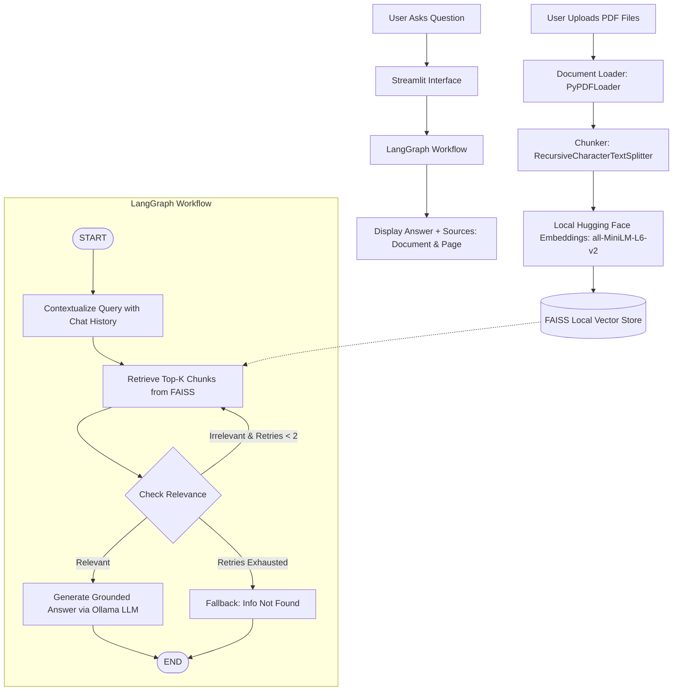

# 🤖 DocuMind AI — Intelligent Document Q&A System

**DocuMind AI** is a production-ready, portfolio-quality Retrieval-Augmented Generation (RAG) system built with **Python 3.11+**, **LangChain**, **LangGraph**, **FAISS**, **Hugging Face Local Embeddings**, **Ollama Local LLM**, and **Streamlit**.

It operates **100% locally and free of charge**—with **zero API keys**, **zero credit balance issues**, and **complete document privacy**.

---

## 🌟 Table of Contents
1. [Overview: What is Local RAG?](#-overview-what-is-local-rag)
2. [Key Features](#-key-features)
3. [System Architecture](#-system-architecture)
4. [LangGraph Workflow Explained](#-langgraph-workflow-explained)
5. [Project Structure](#-project-structure)
6. [Windows Beginner Setup Guide (VS Code)](#-windows-beginner-setup-guide-vs-code)
7. [Step-by-Step Installation](#-step-by-step-installation)
8. [Running the Application](#-running-the-application)
9. [Automated Testing](#-automated-testing)
10. [Troubleshooting & Windows FAQs](#-troubleshooting--windows-faqs)

---

## 📖 Overview: What is Local RAG?

Standard cloud AI APIs require recurring paid credits and send your sensitive private documents to external servers. When credits run out, you hit errors like `429 insufficient_quota / credit_balance_exhausted`.

**DocuMind AI solves this with a completely local, open-source stack:**
- **Zero API Costs**: Runs entirely on your local machine using Ollama and Hugging Face.
- **Complete Privacy**: Your PDF documents never leave your computer.
- **Accurate Grounding**: Answers are derived strictly from your uploaded files, complete with page citations.
- **Hallucination Guardrails**: If information is absent, the system explicitly states it cannot be found rather than fabricating an answer.

---

## 🚀 Key Features

- **100% Free & Offline**: No OpenAI API key or paid subscription needed.
- **Multi-PDF Document Ingestion**: Upload one or several PDF files simultaneously.
- **Intelligent Chunking**: Recursive text splitting (`1000` chars, `200` overlap) preserves paragraph context.
- **Local Hugging Face Embeddings**: Fast, compact `sentence-transformers/all-MiniLM-L6-v2` runs efficiently on standard laptop CPUs (~80MB).
- **FAISS Vector Database**: High-speed local similarity search with disk persistence (`vectorstore/faiss_index/`).
- **LangGraph State Machine**: Cyclic workflow coordinating query contextualization, vector retrieval, relevance grading, and grounded generation.
- **Auditable Source Citations**: Every answer lists the source document name and exact 1-based page number.
- **Conversational Memory**: Remembers previous turns to contextualize follow-up questions (e.g., "Give me an example of it").
- **Modern Streamlit UI**: Intuitive web interface with document status, parameter tuning, and developer debug tracing.

---

## 🏛️ System Architecture



---

## 🔄 LangGraph Workflow Explained

Unlike rigid linear pipelines, **DocuMind AI** utilizes [LangGraph](https://github.com/langchain-ai/langgraph) to coordinate an intelligent state machine:

1. **State (`RAGState`)**: A typed dictionary holding the question, standalone rewritten query, chat history, retrieved documents, similarity scores, answer, sources, retry count, and debug trace.
2. **Contextualize Node**: Uses the local LLM and chat history to reformulate ambiguous follow-up questions into standalone search queries.
3. **Retrieve Node**: Queries the local FAISS index for the Top-K closest vector matches.
4. **Check Relevance Node**: Evaluates whether the retrieved passages actually contain information relevant to the question.
5. **Conditional Branching**:
   - **If Relevant**: Routes to the `generate` node, which feeds the context and question to the local LLM with strict grounding instructions.
   - **If Irrelevant & Retries < 2**: Retries retrieval to find better context.
   - **If Retries Exhausted**: Routes to the `fallback` node: *"I could not find this information in the uploaded documents."*
6. **Source Citations**: Extracted directly from `doc.metadata["source"]` and `doc.metadata["page"]` and formatted into clear citation badges.

---

## 📂 Project Structure

```text
DocuMind-AI/
│
├── data/
│   └── documents/                  # Uploaded PDF files and sample notes
│       ├── sample_ai_notes.pdf
│       └── sample_test.txt
│
├── vectorstore/
│   └── faiss_index/                # Local FAISS index files (index.faiss, index.pkl)
│
├── src/
│   ├── __init__.py
│   ├── config.py                   # Central settings (models, paths, thresholds)
│   ├── document_loader.py          # PyPDF loader with metadata extraction
│   ├── chunker.py                  # RecursiveCharacterTextSplitter logic
│   ├── embeddings.py               # Hugging Face / Sentence Transformers factory
│   ├── vector_store.py             # FAISS index creation, persistence, and loading
│   ├── retriever.py                # Similarity search and score formatting
│   ├── prompts.py                  # Strict grounding prompts preventing hallucinations
│   ├── chains.py                   # LCEL chains and ChatOllama initialization
│   ├── graph.py                    # LangGraph StateGraph definition and execution
│   └── utils.py                    # PDF validation, file saving, and citation formatting
│
├── app/
│   └── streamlit_app.py            # Streamlit web application frontend
│
├── tests/
│   ├── __init__.py
│   ├── test_loader.py              # Tests for PDF loading and metadata preservation
│   ├── test_chunking.py            # Tests for text splitting boundaries
│   └── test_retriever.py           # Offline tests for FAISS vector search
│
├── .env.example                    # Sample environment configuration (free / local)
├── .gitignore                      # Git ignore rules (virtualenvs, cache, index files)
├── requirements.txt                # Python package dependencies
├── README.md                       # Documentation & Windows setup guide
└── run.py                          # Convenient one-click application launcher
```

---

## 🖥️ Windows Beginner Setup Guide (VS Code)

This project is optimized for development on Windows using Visual Studio Code. Follow these steps from start to finish:

```text
VS Code
  ↓
Open project folder (C:\Users\DELL\Desktop\RAG)
  ↓
Open Terminal (Ctrl + `)
  ↓
Install Ollama & pull model
  ↓
Activate virtual environment
  ↓
Install requirements
  ↓
Run Streamlit
```

---

## 🛠️ Step-by-Step Installation

### Step 1 — Install Ollama
1. Download and run the Windows installer from [ollama.com/download](https://ollama.com/download).
2. Follow the on-screen installer instructions.

### Step 2 — Verify Ollama in Terminal
Open PowerShell or Command Prompt in VS Code (`Ctrl + ` `) and run:
```bash
ollama --version
```
You should see `ollama version is 0.x.x`.

### Step 3 — Download the Local LLM Model
Download the lightweight, capable `llama3.2:3b` model (optimized for standard laptops):
```bash
ollama pull llama3.2:3b
```
*(Alternative for low-RAM systems: `ollama pull qwen2.5:3b` or `ollama pull llama3.2:1b`)*

### Step 4 — Test the Model
Verify the model responds locally:
```bash
ollama run llama3.2:3b
```
Type `hi` to verify, then type `/bye` to exit the chat prompt. Keep Ollama running in the background.

### Step 5 — Set Up Python Environment
In your VS Code terminal at the project root:
```bash
python -m venv .venv
```
Activate the virtual environment:
```bash
.venv\Scripts\activate
```
*(You will see `(.venv)` appear at the beginning of your terminal line).*

### Step 6 — Install Python Dependencies
Install the required packages:
```bash
pip install -r requirements.txt
```

---

## 🚀 Running the Application

Make sure Ollama is running, then launch DocuMind AI using either:

```bash
python run.py
```
OR:
```bash
streamlit run app/streamlit_app.py
```

Your browser will automatically open to `http://localhost:8501`.

### How to Use:
1. **Upload Documents**: Use the sidebar to upload one or more PDF files (or test with the included `data/documents/sample_ai_notes.pdf`).
2. **Process Documents**: Click `⚡ Process`. The system extracts text, generates local Hugging Face embeddings, and stores them in FAISS.
3. **Ask Questions**: Ask questions in the chat! DocuMind AI retrieves relevant passages, feeds them to the local Ollama LLM, and provides grounded answers with source citations.

---

## 🧪 Automated Testing

DocuMind AI includes an offline, deterministic unit test suite using `pytest`. Tests run completely locally without needing Ollama or API credits by leveraging deterministic test embeddings:

```bash
pytest
```
Expected output:
```text
============================= 16 passed in 3.23s =============================
```

---

## ❓ Troubleshooting & Windows FAQs

### 1. `'ollama' is not recognized as the name of a cmdlet or program`
- **Cause**: Ollama was recently installed but VS Code's terminal has not reloaded its PATH environment variable.
- **Solution**: Completely close and reopen VS Code. If still not recognized, verify Ollama is installed in `C:\Users\<YourUser>\AppData\Local\Programs\Ollama` and added to your User PATH.

### 2. `Connection refused (localhost:11434)` / `Ollama is not running`
- **Cause**: The Ollama background service is not running.
- **Solution**: Start Ollama by searching for "Ollama" in the Windows Start Menu, or open a separate terminal window and run:
  ```bash
  ollama serve
  ```

### 3. `model 'llama3.2:3b' not found`
- **Cause**: The model has not been downloaded yet.
- **Solution**: Pull the model in your terminal:
  ```bash
  ollama pull llama3.2:3b
  ```

### 4. Sentence Transformers downloading model on first run
- **Explanation**: The first time you click **Process Documents**, Hugging Face automatically downloads the compact `sentence-transformers/all-MiniLM-L6-v2` model (~80 MB) to your local cache (`~/.cache/huggingface/hub`). Subsequent runs load instantly from disk offline.

### 5. FAISS installation error on Windows
- **Solution**: Ensure you are using `faiss-cpu` (not `faiss`), which is pre-compiled for Windows:
  ```bash
  pip install faiss-cpu
  ```

---

## 📜 License & Acknowledgments

Built with [LangChain](https://github.com/langchain-ai/langchain), [LangGraph](https://github.com/langchain-ai/langgraph), [Ollama](https://ollama.com/), [Hugging Face](https://huggingface.co/), [FAISS](https://github.com/facebookresearch/faiss), and [Streamlit](https://streamlit.io/).
